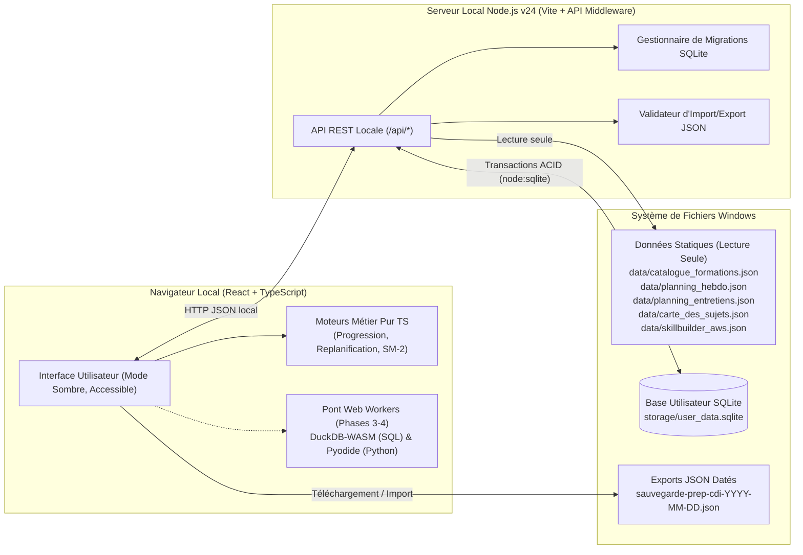

# Architecture Technique de l'Application (Phase 2)

**Date de conception :** 31 octobre 2026  
**Auteur :** Antigravity (Architecte logiciel senior & Développeur Full-Stack)  
**Cible :** Poste de travail Windows local, hors connexion, zéro budget

---

## 1. Vue d'Ensemble et Choix de la Stack

L'application est conçue selon une architecture **Full-Stack TypeScript locale unifiée**, combinant la réactivité d'une interface moderne (React 19 + Vite + TypeScript) et la fiabilité d'une persistance transactionnelle sur disque dans un **fichier SQLite local** (`storage/user_data.sqlite`) propulsé par le module natif `node:sqlite` (`DatabaseSync` de Node.js v24).

### Pourquoi cette stack ?
1. **Zéro compilation native fragile sur Windows :** Node.js v24 intègre nativement `node:sqlite` (`DatabaseSync`). Contrairement à `better-sqlite3` ou `sqlite3` qui nécessitent `node-gyp` et les outils C++ Visual Studio, `node:sqlite` fonctionne immédiatement hors boîte sur Windows sans dépendance binaire externe.
2. **Persistance réelle hors navigateur :** Conformément aux exigences de la Phase 2, les données utilisateur ne sont pas confinées au stockage éphémère du navigateur (`localStorage` ou `IndexedDB` seul) : elles sont écrites de façon atomique (mode WAL) dans le fichier physique `storage/user_data.sqlite` sur le disque local, complétées par un système d'export/import JSON daté avec validation de schéma.
3. **Démarrage en une seule commande (`demarrer.bat` ou `npm run start`) :** Le serveur API SQLite est intégré à la fois comme middleware Vite (`vite.config.ts`) et comme serveur HTTP autonome (`server/standalone.ts`). Un seul processus écoute sur `http://localhost:5173`, servant l'interface et l'API REST locale `/api/*` sans aucun conflit de port ni configuration réseau.
4. **Prête pour les Phases 3 et 4 (Web Workers) :** L'architecture frontale inclut dès maintenant les gestionnaires et contrats de communication asynchrone par Web Workers (`src/workers/`) destinés à héberger **DuckDB-WASM** (exécution SQL analytique en local) et **Pyodide** (exécution Python 3 en WebAssembly) sans jamais bloquer le fil d'exécution principal (UI thread).



---

## 2. Séparation Stricte : Données Statiques vs Données Utilisateur

Une règle d'or de l'architecture est l'isolation totale entre le **référentiel pédagogique statique** et l'**état d'avancement de l'utilisateur** :

| Catégorie | Emplacement | Accès | Comportement lors d'une mise à jour |
| :--- | :--- | :--- | :--- |
| **Données Statiques** | `data/catalogue_formations.json`<br>`data/planning_hebdo.json`<br>`data/planning_entretiens.json`<br>`data/carte_des_sujets.json`<br>`data/skillbuilder_aws.json`<br>`docs/01_verification_examens.md` | **Lecture seule** | Peuvent être enrichies ou corrigées à tout moment (ex. ajout de chapitres en Phase 3) sans jamais altérer la base SQLite utilisateur. |
| **Données Utilisateur** | `storage/user_data.sqlite` | **Lecture / Écriture ACID** | Référence les entités statiques par clés stables (`course_key` + `item_index`, `task_id`, `topic_id`, `cert_code`). |

Aucune leçon n'est pré-cochée : le catalogue ne contient plus aucun `done: true` et la migration `v2` vide la table `lesson_progress` (décision D-13). Les 5 cours, les 3 certifications et les 44 podcasts démarrent à 0 % (leçon 1) le lundi 9 novembre 2026. Seule la table SQLite fait foi pour l'avancement utilisateur.

---

## 3. Schéma de Données SQLite Versionné et Migrations

La base SQLite `storage/user_data.sqlite` est gérée par un moteur de migrations séquentielles (`src/server/db.ts`). Chaque migration est enregistrée dans la table `schema_migrations`. La version courante du schéma en Phase 2 est **`v1`** (`schema_version = 1`).

### Diagramme Entité-Relation (Schéma v1)

```mermaid
erDiagram
    SCHEMA_MIGRATIONS {
        int version PK
        string name
        string applied_at
    }
    LESSON_PROGRESS {
        string course_key PK
        int item_index PK
        int done "0 ou 1"
        string updated_at
    }
    TASK_STATES {
        string task_id PK "ex: W01-C1, W04-I3"
        string status "todo | in_progress | done | postponed | skipped | compressed"
        int target_week "Semaine d'affectation (1 a 22)"
        int custom_duration_min "Duree recalibree ou compressee"
        string completed_at
        string notes
        string updated_at
    }
    TASK_HISTORY {
        int id PK
        string task_id FK
        string action "complete | postpone | compress | skip | edit_duration | restore"
        int from_week
        int to_week
        int old_duration_min
        int new_duration_min
        string reason
        string created_at
    }
    STUDY_SESSIONS {
        int id PK
        string task_id "Optionnel: tache rattachee"
        int week_number "Semaine (1 a 22)"
        string category "certification | interview"
        string date "YYYY-MM-DD"
        int duration_min
        string mode "timer | manual"
        string notes
        int is_demo "0 (reel) ou 1 (DEMO)"
        string created_at
    }
    MOCK_EXAMS {
        int id PK
        string cert_code "CLF-C02 | DEA-C01 | DBT"
        string source "Nom de l'examen blanc"
        string date "YYYY-MM-DD"
        real score_pct "Score en pourcentage (0-100)"
        int raw_score "Ex: 780 sur 1000"
        string domain_scores_json "JSON des scores par domaine"
        string notes
        int is_demo "0 (reel) ou 1 (DEMO)"
        string created_at
    }
    ERROR_JOURNAL {
        int id PK
        string cert_code "CLF-C02 | DEA-C01 | DBT"
        string domain_id "Domaine officiel"
        string topic_id "Lien vers carte_des_sujets.json"
        string question_summary "Resume reformule de l'erreur"
        string root_cause "Lacune conceptuelle, piege d'enonce, inattention..."
        string action_to_review "Lecons ou doc a revoir"
        int resolved "0 (a revoir) ou 1 (maitrise)"
        int is_demo "0 (reel) ou 1 (DEMO)"
        string created_at
    }
    FLASHCARDS {
        string id PK
        string topic_id "Sujet technique rattache"
        string cert_code "CLF-C02 | DEA-C01 | DBT | INTERVIEW"
        string front "Question ou concept"
        string back "Reponse synthese"
        string provenance "officielle | communaute (URL) | generee par IA et verifiee dans la documentation (date) | generee par IA non verifiee"
        string source_url "URL et date si applicable"
        int repetitions "Compteur de reussites consecutives SM-2"
        int interval_days "Intervalle courant en jours"
        real ease_factor "Facteur de facilite SM-2 (defaut 2.5)"
        string due_date "YYYY-MM-DD"
        string last_reviewed_at
        int is_demo "0 (reel) ou 1 (DEMO)"
        string created_at
    }
    SETTINGS {
        string key PK
        string value_json
        string updated_at
    }
```



### Règles de Migration et Intégrité
- Au démarrage du serveur, `runMigrations(db)` vérifie les versions présentes dans `schema_migrations` et exécute dans une transaction SQLite atomique toute migration non encore appliquée.
- En Phase 3 et Phase 4, l'ajout des tables `code_submissions` (exercices SQL/Python) et `interview_simulations` se fera via la migration `v2` sans toucher aux tables `v1`.

---

## 4. Moteurs Métier et Algorithmes Clés

### 4.1 Calcul de Progression Pondérée (`src/domain/progression.ts`)
- Chaque cours Udemy possède dans `catalogue_formations.json` des éléments de type `lec` (vidéo avec durée en minutes), `quiz` (durée estimée dans `meta.quiz_minutes` : 10 à 15 min) et `ex` (durée estimée dans `meta.exercise_minutes` : 20 à 30 min), ainsi qu'un facteur multiplicateur de temps d'étude actif (`meta.time_factors` : `1.15` pour Merico, `1.4` pour Maarek et Toth, `1.3` pour Nikolai, `1.2` pour Weigel).
- La progression d'un cours, d'un bloc ou d'une certification est **pondérée par les minutes réelles estimées**, et non par un simple comptage naïf du nombre de leçons :
  $$\text{Progression (\%)} = \frac{\sum_{i \in \text{terminés}} \text{minutes\_estimées}(i)}{\sum_{i \in \text{périmètre}} \text{minutes\_estimées}(i)} \times 100$$
- Pour les certifications globales (CLF-C02, DEA-C01, dbt), l'indicateur combine :
  1. La progression pondérée en minutes sur le cours principal (et les blocs indispensables).
  2. La progression pondérée des tâches hebdomadaires du planning (`task_states`).

### 4.2 Moteur de Replanification Sans Dette (`src/domain/rescheduler.ts`)
Implémente la spécification corrigée de `docs/05_planning_entretiens_et_replanification.md` :
1. **Plafond strict (Principe 1) :** `max_weekly_minutes = 660` (11 h) en semaine normale, `360` (6 h) en semaine allégée (`light_week = true`, semaines 7 de Noël et 8 du Nouvel An).
2. **Priorité à l'examen le plus proche (Principe 2 corrigé) :** Les tâches à replanifier sont triées selon la phase en cours (`getTaskExamPriorityRank`) : semaines 1 à 3, `CLF-C02` (27 nov. 2026) > `dbt` > Entretiens ; semaines 4 à 9, `dbt` (8 janv. 2027, urgence n°1) > Entretiens > `DEA-C01` ; semaines 10 à 22, `DEA-C01` (19 mars 2027) > Entretiens.
3. **Sacrifice des Bonus en premier (Principe 3) :** En cas de dépassement du plafond ou de retard, toutes les tâches `bonus` de la semaine courante et des semaines d'absorption passent automatiquement au statut `skipped` avant toute compression du socle `core`.
4. **Compression proportionnelle des chapitres d'entretien (Principe 4 corrigé) :** Au lieu d'une durée fixe arbitraire de 15 minutes, lorsqu'une tâche d'entretien doit être compressée en « mode fiche mémo » pour tenir dans le plafond après purge des bonus, sa durée est multipliée par un facteur de compression configurable (par défaut `0.5`, soit 50 % de la durée initiale, avec un plancher minimal de `15` minutes et un plafond de `30` minutes par fiche condensée).
5. **Explicabilité totale :** Chaque exécution retourne un journal structuré (`changes[]` et `explanation_fr`) expliquant à l'utilisateur quelles tâches bonus ont été sacrifiées, quelles tâches Core ont été déplacées et dans quelle semaine, et quel est le nouveau total d'heures de chaque semaine impactée.

### 4.3 Moteur de Répétition Espacée SM-2 (`src/domain/spacedRepetition.ts`)
- Implémente l'algorithme **SM-2 (SuperMemo 2)** avec 4 niveaux de réponse :
  - `0 (À revoir / Oublié)` : réinitialise `repetitions = 0` et `interval_days = 1`.
  - `3 (Difficile)` : incrémente `repetitions`, réduit légèrement `ease_factor` (plancher `1.3`), calcule le prochain intervalle.
  - `4 (Correct)` : progression standard ($1\text{ j} \rightarrow 6\text{ j} \rightarrow \text{round}(I \times EF)$).
  - `5 (Facile)` : augmente `ease_factor` et espace davantage la prochaine révision.
- **Règle d'intégrité :** Une carte ou une notion n'est considérée comme « Maîtrisée » que lorsque `repetitions >= 3` et `interval_days >= 14` (jamais parce qu'un cours vidéo a été coché).
- **Traçabilité obligatoire :** Toute carte créée exige l'une des 4 étiquettes de provenance : `officielle`, `communauté (URL)`, `générée par IA et vérifiée dans la documentation (date)` ou `générée par IA non vérifiée`.

---

## 5. Sauvegarde, Restauration et Gestion des Données DÉMO

1. **Export JSON daté :** Génère un fichier `sauvegarde-prep-cdi-YYYY-MM-DD.json` contenant une enveloppe typée :
   - `schema_version` (`1`), `exported_at` (ISO 8601), `app` (`pack-antigravity-prep-cdi`), et l'intégralité des tables utilisateur (`lesson_progress`, `task_states`, `task_history`, `study_sessions`, `mock_exams`, `error_journal`, `flashcards`, `settings`).
2. **Import avec validation stricte :** Avant toute écriture en base, `validateBackupPayload()` vérifie la structure, la version du schéma, les types de chaque tableau et les contraintes d'énumération (statuts, étiquettes de provenance). Si le fichier est valide, la restauration s'exécute dans une transaction atomique SQLite (`BEGIN IMMEDIATE ... COMMIT`).
3. **Rappel hebdomadaire de sauvegarde :** Le tableau de bord compare la date courante à `settings.last_backup_at` et affiche une bannière d'alerte dès que plus de 7 jours se sont écoulés sans sauvegarde exportée.
4. **Isolation des données DÉMO :** Par défaut, l'application démarre avec **zéro résultat fictif** (aucun examen blanc pré-rempli, aucune séance d'étude fictive). Si l'utilisateur souhaite tester visuellement les graphiques ou la répétition espacée, un bouton explicite en Réglages permet d'injecter un jeu d'essai dont chaque enregistrement porte `is_demo = 1` et un badge visuel `[DÉMO]`, supprimable en un seul clic (`DELETE FROM ... WHERE is_demo = 1`) sans toucher aux vraies données.

---

## 6. Préparation de l'Architecture pour les Phases 3 et 4 (Web Workers)

Le dossier `src/workers/` définit dès la Phase 2 l'architecture d'exécution isolée pour les futurs moteurs d'exercices interactifs :
- `src/workers/types.ts` : Contrats de messages typés (`WorkerRequest`, `WorkerResponse`, `SqlExecutionResult`, `PythonExecutionResult`).
- `src/workers/sandboxBridge.ts` : Client asynchrone côté React gérant le cycle de vie des Web Workers, les timeouts d'exécution (protection contre les boucles infinies en live coding) et l'état de chargement de **DuckDB-WASM** (SQL) et **Pyodide** (Python).

---

## 7. Arborescence du Projet

```text
pack-antigravity-prep-cdi/
├── data/                                 # Données statiques de référence (lecture seule)
│   ├── catalogue_formations.json         # 5 cours Udemy (~1 300 leçons) + AWS Skill Builder
│   ├── planning_hebdo.json               # Planning certifications (22 semaines)
│   ├── planning_entretiens.json          # Planning entretiens (22 semaines, 2 400 min)
│   ├── carte_des_sujets.json             # Correspondance sujets techniques <-> leçons
│   ├── skillbuilder_aws.json             # Ressources officielles AWS Skill Builder
│   ├── planning_hebdo_lisible.md         # Version lisible du planning
│   └── programme_cible_chapitres.md      # Liste cible initiale des chapitres
├── docs/                                 # Documentation d'ingénierie et rapports
│   ├── 01_verification_examens.md        # Programmes officiels vérifiés (CLF, DEA v1.1, dbt)
│   ├── 02_analyse_marche.md              # Analyse du marché CDI Data/AI
│   ├── 03_sources_entretiens.md          # Sources d'autorité entretiens
│   ├── 04_programme_pedagogique.md       # Programme pédagogique calibré
│   ├── 05_planning_entretiens_et_replanification.md # Spécification replanification
│   ├── 06_bibliotheque_ressources.json   # Bibliothèque de sources JSON
│   ├── ARCHITECTURE.md                   # Présent document d'architecture
│   ├── DECISIONS.md                      # Registre des décisions techniques et pédagogiques
│   ├── GUIDE_UTILISATEUR.md              # Guide d'installation et d'utilisation quotidienne
│   ├── HYPOTHESES.md                     # Registre des hypothèses
│   ├── RAPPORT_PHASE_1.md                # Rapport de la Phase 1
│   └── RAPPORT_PHASE_2.md                # Rapport final de la Phase 2
├── storage/                              # Stockage persistant local (créé automatiquement)
│   └── user_data.sqlite                  # Base de données SQLite locale de l'utilisateur
├── src/
│   ├── domain/                           # Logique métier pure (testée unitairement)
│   │   ├── types.ts                      # Modèles de données partagés Client/Serveur
│   │   ├── progression.ts                # Calculs de progression pondérée par les minutes
│   │   ├── rescheduler.ts                # Moteur de replanification dynamique (6 scénarios)
│   │   ├── spacedRepetition.ts           # Algorithme SM-2 et règles de maîtrise
│   │   ├── readiness.ts                  # Évaluation de préparation aux 3 examens
│   │   └── backupValidator.ts            # Validation de schéma d'import/export JSON
│   ├── server/                           # Backend local Node.js + SQLite
│   │   ├── db.ts                         # Connexion node:sqlite, schéma v1 et migrations
│   │   ├── api.ts                        # Routeur REST (/api/*) et logique de persistance
│   │   └── standalone.ts                 # Point d'entrée serveur autonome
│   ├── workers/                          # Préparation Phases 3 & 4 (SQL & Python)
│   │   ├── types.ts                      # Interfaces des Web Workers DuckDB-WASM & Pyodide
│   │   └── sandboxBridge.ts              # Gestionnaire de workers avec timeout d'exécution
│   ├── components/                       # Composants d'interface React (Mode sombre, FR)
│   │   ├── DashboardView.tsx             # 1. Tableau de bord hebdomadaire et comptes à rebours
│   │   ├── PlanningView.tsx              # 2 & 3. Planning Semaine/Mois + Replanification
│   │   ├── CoursesView.tsx               # 4. Suivi des 5 cours Udemy (blocs, plages, leçons)
│   │   ├── CertificationsView.tsx        # 5. Espaces CLF-C02, DEA-C01 et dbt + Blancs + Erreurs
│   │   ├── SessionsView.tsx              # 6. Journal des séances (minuteur + saisie + bilan)
│   │   ├── SpacedRepetitionView.tsx      # 7. Répétition espacée SM-2 et création de cartes
│   │   └── SettingsView.tsx              # 8. Réglages, Sauvegarde/Restauration, Démo
│   ├── App.tsx                           # Navigation principale (clavier + responsive)
│   ├── apiClient.ts                      # Client HTTP typé pour l'API locale
│   ├── index.css                         # Design system sobre et moderne en mode sombre
│   └── main.tsx                          # Point d'entrée React
├── tests/
│   ├── unit/                             # Tests unitaires Vitest
│   │   ├── progression.test.ts           # Tests du calcul pondéré par les minutes
│   │   ├── rescheduler.test.ts           # Tests des 6 scénarios chiffrés recalculés
│   │   ├── spacedRepetition.test.ts      # Tests SM-2 et règle de non-maîtrise automatique
│   │   └── backupValidator.test.ts       # Tests d'export, validation et restauration
│   └── e2e/                              # Tests de bout en bout Playwright
│       └── app.spec.ts                   # Parcours complet dans un vrai navigateur Chromium
├── demarrer.bat                          # Script de lancement en un clic sous Windows
├── package.json                          # Dépendances et scripts (npm run start, test, test:e2e)
├── playwright.config.ts                  # Configuration Playwright
├── tsconfig.json                         # Configuration TypeScript stricte
└── vite.config.ts                        # Configuration Vite + plugin API SQLite local
```

---

## Mode Cloud (Cloudflare, novembre 2026)

Le même code métier tourne aussi en ligne pour l'usage mobile : Worker Cloudflare `prep-cdi` (interface + API), base SQLite hébergée dans un Durable Object (mêmes migrations), podcasts dans le bucket R2 privé `prep-cdi-audios`, accès protégé par Cloudflare Access. Détails, procédure et invariants : `docs/DEPLOIEMENT_CLOUD.md` et section 5 de `AGENTS.md`.
